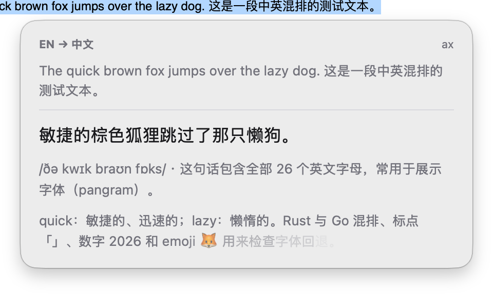

# macOS 技术验证

**日期：** 2026-11-01 **平台：** macOS 27.0.1，Apple Silicon，mygo v0.7.4，Go 1.27.3
**问题：** mygo + Rust 能否做到快捷键 → 取词 → 不抢焦点的弹窗 → 流式动画？
**结论：** 可行。负责人亲自试用后认为流畅。

## 实测数据

| 项目 | 结果 |
|---|---|
| 焦点 | 弹窗出现后 TextEdit 仍在前台，选区保持激活 |
| 快捷键到首帧 | 真实按键约 114ms；定时触发 3 轮 30–57ms |
| AX 取词（TextEdit） | 30/30 成功，约 14–27ms，大部分花在启动 `lsappinfo` 上 |
| Cmd+C 兜底 | 可用，约 150ms |
| 帧间隔 | 定时触发最差约 22ms；真实按键那轮最差 36ms，有 4 帧超过 20ms |
| 内存 | phys_footprint 41–47MB，RSS 约 110MB |
| 空闲 CPU | 0% |
| 体积 | 主程序 9MB，helper 约 331KB |
| 排版 | 中英混排、音标、标点和 emoji 回退正常 |

## 发现

- 系统级 `AXFocusedUIElement` 返回 `-25204`，按前台应用查询才成功。
- Chrome 的 AX 返回 `-25212`，读不到选区，只能依赖 Cmd+C。Electron 应用未测。
- 调用 `pbpaste` 和 `pbcopy` 必须设置 UTF-8 的 `LANG`，否则中文乱码，并且会把乱码写回剪贴板。
- 玻璃材质作用于整个窗口，所以高度动画要真实改变窗口尺寸，不能用"透明大窗口 + 内部动画"。
- `Content` 窗口不支持 `FitContent`，要自己测量高度。
- 拦截 `OnClose` 后，`App.Quit` 不会退出，SIGTERM 也结束不了，需要自己处理。
- 第一轮运行时有一次 AX 和 Cmd+C 都失败，当时光标也移动了，原因未确认。

## 未验证

- Safari 页面选区（测试时选中的是地址栏，结果无效）。
- Electron 应用。
- 动画没有录到视频，抖动只靠负责人肉眼判断。
