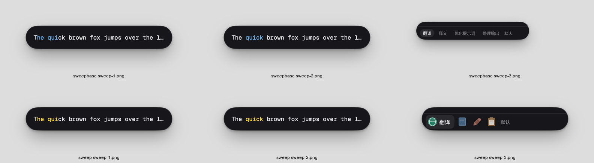
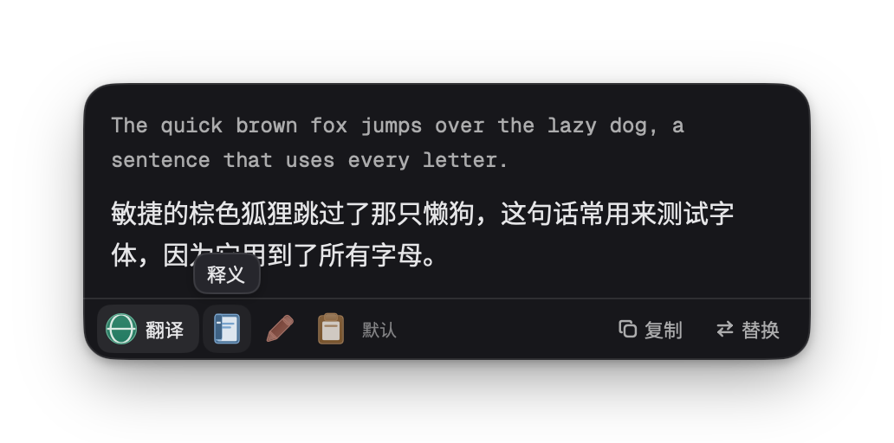

# 面板接入图标和荧光黄（GLO-48）

**日期：** 2026-11-06　**平台：** macOS 27，Apple M4，主显示器 160Hz（帧预算 6.25 ms）

## 结论

- **不退回静态图标。** 按 issue 的约定，加动效后帧间隔变差才退回。p50 都是 6.25 ms，p95 前后重叠，悬停时图标动画没有掉帧。
- **内存有上涨，但不泄漏。** 动画刚结束时多约 4–14 MB，峰值多约 15–30 MB。开关 20 次不增长，关闭 12 秒后的 Go 堆在用量只多不到 1 MB。上涨留给 GLO-50。（更正：这里原来写“面板打开时”，其实量到的是瞬时值，见下面“内存”一节。）
- **真实鼠标没有试过。** 脚本伪造了指针，悬停和 tip 是在真实窗口里画出来的，但指针是假的。

## 怎么测

- 用 `go build -overlay` 给发布构建（`-trimpath -tags mygo_noinspector -s -w`）加一段脚本，不进仓库。真实窗口（Metal），隔离的 HOME，模拟服务。
- 窗口点击穿透，脚本替换 `panel.local` 来伪造指针。不发按键，不碰其他应用。
- 基线是 main 的 `b9153ad`，前后版本交替跑。程序前后只差 160 字节（都带脚本）。
- 帧间隔：在 `view` 开头记时间。每次运行 5 轮，每轮依次是打开 450 ms、流式 1800 ms、沿页脚悬停 7 个点（每点 520 ms）、切换功能 4 次（每次 1700 ms）、关闭 400 ms。第 1 轮记“首次”，后 4 轮记“再次”。
- 内存：`footprint -p`。分两种：只跑上面的脚本后关闭 12 秒；再开关 20 次，每次都悬停一个图标，在最后一次打开时和关闭 12 秒后各量一次。每次关闭后强制 GC，记 Go 堆，并存 heap profile。

## 帧间隔（已实测）

基线 6 次运行，这次 5 次运行，下表都是各次运行之间的范围，单位 ms。

| 阶段 | 基线 p50 | 这次 p50 | 基线 p95 | 这次 p95 | 基线最长一帧 | 这次最长一帧 |
|---|---|---|---|---|---|---|
| 首次打开 | 6.25–6.26 | 6.25–6.26 | 8.22–12.59 | 9.19–12.62 | 21.41–35.07 | 24.05–31.69 |
| 首次流式 | 6.25 | 6.24–6.25 | 6.33–6.95 | 6.35–7.05 | 8.14–21.84 | 8.23–15.98 |
| 首次切换 | 6.25 | 6.25 | 6.36–6.82 | 6.35–6.37 | 12.43–24.84 | 12.38–22.06 |
| 再次打开 | 6.25 | 6.25–6.26 | 8.23–9.71 | 7.97–9.00 | 12.76–40.47 | 12.50–17.55 |
| 再次流式 | 6.25 | 6.25 | 6.34–8.22 | 6.34–6.38 | 9.23–68.82 | 9.09–65.50 |
| 再次切换 | 6.25–6.26 | 6.25 | 6.37–6.93 | 6.38–6.54 | 14.15–35.09 | 13.71–25.85，另有一次 1008.09 |

悬停没有前后对比：脚本伪造的指针只有新代码读，基线不响应，几乎不出帧。所以只能和帧预算比：

| 阶段 | 帧数 | p50 | p95 | 最长一帧 | 单帧构建（p99.9） |
|---|---|---|---|---|---|
| 首次悬停（图标帧第一次解析） | 224–228 | 6.25 | 6.35–6.91 | 6.43–12.73 | 0.66–1.74 |
| 再次悬停 | 770–910 | 6.25 | 6.36–6.39 | 7.26–26.89 | 0.76–1.44 |

构建时间：再次切换的 p95 从 0.48–0.54 ms 涨到 0.72–0.77 ms，远低于帧预算。首次打开的 p99.9 从 5.50–12.12 ms 涨到 9.69–17.51 ms，这一帧要解析图标；同一阶段的帧间隔没有变差。

### 没查明的

- **一次 1008 ms 的帧间隔。** 出现在第 3 次运行的“再次切换”，同一次运行的再次悬停帧数也偏少（770，其他是 908–910）。之后又跑了 4 次（其中 2 次是下面的裁剪实验）没有复现。那一轮还没有记录长帧明细，所以不知道它发生在哪一步，也不能排除是这次的改动。基线也有过 174–185 ms（出现在没进上表的两次运行里）。
- **65–69 ms 的长帧。** 基线和这次都有，都落在流式阶段，都只在单次运行里出现。和 GLO-10 的卡顿是否同因，未查。
- **最早一批有两次运行中途退出**（基线和这次各一次），没有 panic，没有崩溃报告，当时没记退出码。之后 14 次都没有再出现，原因未查明。
- **有一次基线跑在 120Hz**（p50 8.33），原因未查，没计入。

## 内存（已实测）

| 场景 | 基线 | 这次 |
|---|---|---|
| 只跑脚本，关闭 12 秒 | 51、54 MB | 59、61、63 MB |
| 再开关 20 次，最后一次打开、动画刚结束时 | 154、157、160、160 MB | 164、168 MB |
| 再开关 20 次，关闭 12 秒 | 60、65、70、71 MB | 66、79 MB |
| 运行中的峰值（`phys_footprint_peak`） | 187–193 MB | 204–220 MB |
| Go 堆在用量（`HeapInuse`），关闭 12 秒（强制 GC 后） | 7.6–7.7 MB | 8.4–8.5 MB |
| Go 向系统要的总量（`Sys`） | 71 MB | 102–106 MB |

- **不泄漏：** 开关 20 次，Go 堆在用量持平；每次关闭后 `iconSet` 都是空的。
- **动画刚结束时的 160 MB，基线也有。** 其中图形内存 56 MB，`Untagged`（主要是 Go 堆）50–58 MB，`Malloc Small` 17–19 MB。这是遮罩缓存已满时量的瞬时值。**更正：** 这里原来写成“面板打开时的 160 MB”，不对。面板静止 2 秒后 mygo 会回收，静止时是 44–69 MB，见 [GLO-50](2026-11-06-glo50-memory.md)。
- **最大的一块是 mygo 的裁剪遮罩缓存。** heap profile 里 `raster.ClipMask` 约占 30 MB，对应 mygo 写死的上限 `idleMaskBytes = 32 << 20`（`internal/gpu/transform.go`）。闲置后会归还。基线开关约 10 次也会涨到同样的位置；这次的脚本跑完就已经满了，原因没查清。
- **多出来的分配：** 脚本期间累计分配从 328 MB 到 472 MB，主要是解析图标帧和 `engine.picture` 绘制图标图片，能被 GC 回收。Go 的堆峰值因此变高，`Sys` 也跟着涨。

### 排除过的假设：芯片的圆角裁剪

功能芯片用了 `.Clip()`，推测面板缩放时每个芯片都要生成新遮罩。改成只在名称移动时才裁剪，跑了 2 次，内存和帧间隔都没有变化（报告时堆 44.8–48.3 MB，打开时 168–172 MB，峰值 204–211 MB），已撤回。

## 视觉（真实窗口截图，已看）

- 胶囊的扫光（上排基线，下排这次）。基线同样有胶囊展开时只露出页脚的过渡帧，不是这次引入的。

  

- 文本页脚、失败状态（重试和修复带字形、钉住点是荧光黄）、Markdown（荧光黄链接、深灰勾选框）、回到底部（带箭头）。
- tip：指针停在另一个功能上 600 ms 后出现，图标同时亮起。

  

## 对比度（WCAG 公式计算，未用眼睛核对）

| 组合 | 对比度 |
|---|---|
| 荧光黄对面板底 | 12.54 |
| 正文对选区（`colorSelected` 叠在面板底上） | 6.81 |
| 白勾对 `inkPlate` | 11.81（旧的白勾对蓝是 2.11，白勾对荧光黄是 1.43，所以勾选框不用荧光黄） |
| 正文对当前功能的底 | 11.48 |
| 正文对 tip 的底（`inkPopup`） | 12.07 |
| 说明文字（`colorHint`）对面板底 | 4.66 |
| 原文（`colorSource`）对面板底 | 7.88 |

## mygo 的悬停（读源码得出，没有单独做事件实验）

`internal/darwin/surface.go:197` 的 tracking options 含 `NSTrackingActiveInActiveApp`，Gloss 从不激活，所以面板里 `Element.Hovered()` 和 `Tooltip()` 都不会生效，原来的 `Tooltip(p.why)` 和功能的悬停色也一直没有效果。点击不受影响，mouseDown 自带位置。

面板改为自己判断：`panel.track` 读指针（每帧，以及 shell 每 33 ms 的轮询），`panel.hover` 记下控件位置，`tipView` 自己画 tip。没有替换 mygo 的 tracking area，因为要用 objc 改私有视图，回归风险更大。

## 页脚放不下长状态文字（基线就有，已修）

`footerRow` 的状态文字不收缩。无界面测试（`Tester`）量了两句失败提示（17 字、21 字），功能栏选“优化提示词”：

| 面板宽 | 基线 | 这次 |
|---|---|---|
| 最窄（基线 340，这次 344） | 复制、替换都被挤出 | 复制、替换都被挤出 |
| 420 | 复制、替换都被挤出 | 复制、替换都被挤出（17 字时复制还露出 8pt） |
| 520 | 17 字时替换被切掉一截；21 字时替换被挤出，复制被切掉一截 | 17 字放得下；21 字时替换只露出 9pt |

状态文字显示期间，这两个按钮按不到。这些提示只在写回失败或结果未确认时出现。

**修复（负责人决定）：** 状态文字不再占页脚的位置，改成浮在按钮上方，样式和 tip 一致，点击穿透。最窄时功能栏和按钮已经占满页脚，收缩放不下；而这些提示说的是下一步该做什么（“请检查原文”），也不能截断。`TestStatusLeavesTheFooterAlone` 检查 344、420、520 三种宽度下按钮位置不变、提示完整。真实窗口（344 宽，最长的功能名和最长的提示）截图看过：

## 未测

- 真实鼠标下的悬停、tip、点击和手感。
- 选区颜色的实际观感。
- 减弱动效（mygo 的 `Spring` 和 `AnimateTo` 按文档会直接到位，图标由 `liveIcon` 处理，都没有在真实窗口里看过）、1 倍屏。
